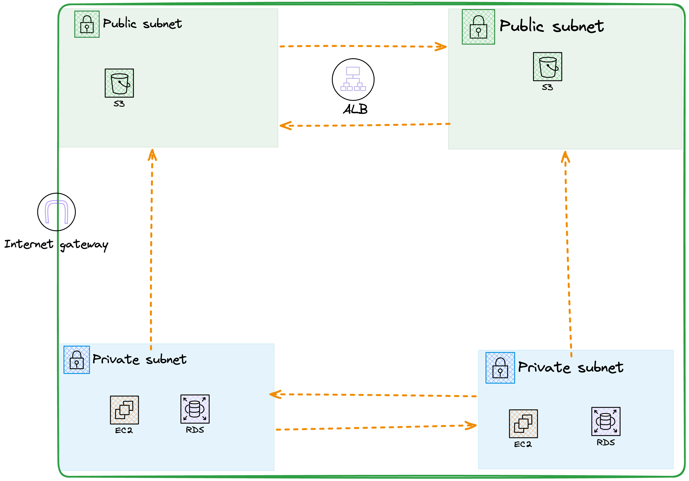

# Multi-Tier AWS Infrastructure with CDK

A production-ready, highly available web application infrastructure deployed on AWS using AWS CDK and TypeScript.

## Architecture



This infrastructure demonstrates:
- **High Availability** across 2 Availability Zones
- **Load Balancing** for traffic distribution
- **Security best practices** with public/private subnet separation
- **Database isolation** in private subnets
- **Infrastructure as Code** using AWS CDK

## What's Deployed

### 🌐 VpcStack
- VPC with CIDR `10.0.0.0/16`
- **Public Subnets** (2 AZs) - For the Application Load Balancer
- **Private Subnets** (2 AZs) - For EC2 web servers
- **Isolated Subnets** (2 AZs) - For RDS database
- Internet Gateway for public internet access
- NAT Gateway for private subnet internet access

### 📦 AlbStack
- Application Load Balancer (ALB) in public subnets
- HTTP listener on port 80
- Security group allowing traffic from the internet
- DNS endpoint for accessing your application

### 🖥️ Ec2Stack
- 2 x T3.MICRO EC2 instances running Amazon Linux 2
- Distributed across 2 Availability Zones
- Auto-installed Apache web server
- Connected to ALB via target groups
- Security group restricting access to ALB only

### 🗄️ RdsStack
- MySQL 8.0 database instance
- T3.MICRO instance type
- 20GB initial storage, scalable to 30GB
- Multi-AZ for high availability
- Encrypted storage for security
- Private isolated subnet (no internet access)
- Auto-generated admin password stored in AWS Secrets Manager

## Technologies Used

- **AWS CDK** - Infrastructure as Code
- **TypeScript** - Type-safe infrastructure definitions
- **CloudFormation** - Infrastructure orchestration
- **AWS Services**: VPC, EC2, ALB, RDS, Security Groups

## Project Structure
my-web-app-infrastructure/
├── bin/
│ └── app.ts # Main orchestrator (creates all stacks)
├── lib/
│ ├── vpc-stack.ts # VPC, subnets, gateways
│ ├── alb-stack.ts # Load balancer configuration
│ ├── ec2-stack.ts # Web servers
│ └── rds-stack.ts # Database
├── package.json
├── tsconfig.json
└── README.md


## How to Deploy

### Prerequisites
- AWS Account with credentials configured
- Node.js 20+ installed
- AWS CDK CLI installed

```bash
npm install -g aws-cdk
```

### Deploy

```bash
# Install dependencies
npm install

# Compile TypeScript
npm run build

# Preview changes
cdk diff

# Deploy to AWS
cdk deploy --all --require-approval never
```

The deployment takes approximately **15-20 minutes** for the full stack.

## How to Test

Once deployed, the ALB DNS name will be output. Open it in your browser:
